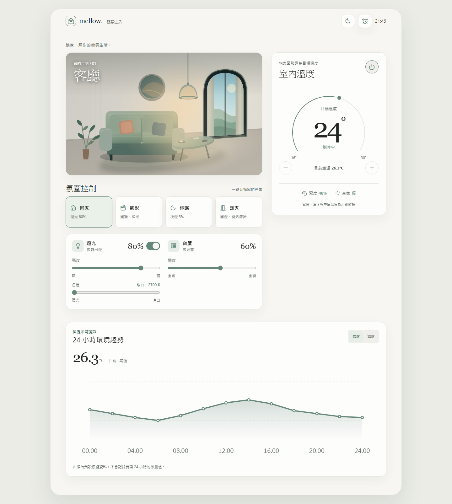
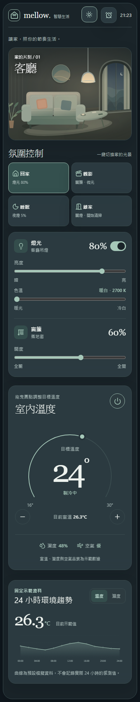

# mellow.｜智慧生活 Smart Home

以 **Vue 3 + TypeScript** 開發的智慧家居互動介面，結合日夜光影、情境切換與裝置控制。使用原創 SVG 客廳場景，即時呈現照明和窗簾變化，並支援桌機、平板與手機操作。

> **Frontend Demo** — 所有裝置與環境數據皆為模擬，不會連接或控制真實家電。

## 畫面預覽





## 核心功能

- **互動式客廳**：原創 SVG 場景；日夜主題、窗簾開度、吊燈亮度與色溫即時影響室內光影。
- **智慧裝置控制**：燈光、窗簾、目標溫度與環境趨勢模擬，支援滑桿、按鈕及鍵盤操作。
- **一鍵情境切換**：回家、觀影、睡眠、離家，快速套用對應的裝置設定。
- **早晚排程**：使用滾輪時間選擇器設定排程，支援滑鼠、觸控與鍵盤操作。
- **狀態保存與 RWD**：使用 Pinia 管理狀態、localStorage 保存設定，適配桌機、平板與手機。

## 技術架構

| 類別 | 技術 |
| --- | --- |
| 前端 | Vue 3、TypeScript、Vite、Vue Router |
| 狀態與樣式 | Pinia、SCSS、CSS Variables、Lucide Icons |
| 測試 | Playwright、vue-tsc |

## 本機執行

需要 Node.js 與 npm。在專案根目錄執行：

```bash
npm ci
npm run dev
```

```bash
npm run build       # 型別檢查與正式版建置
npm run preview     # 預覽正式版
npm run test:e2e    # Playwright 瀏覽器測試
```

首次執行 E2E 測試前，請先執行 `npx playwright install chromium`。

## 專案說明

本專案為**純前端作品集 Demo**，不包含後端、帳號、雲端同步或真實 IoT 設備串接。裝置設定保存在目前瀏覽器；環境數據為模擬資料。早晚排程僅在**網頁開啟期間**依台北時間檢查與執行，關閉網頁後不會在背景觸發。

---
**mellow.** — 讓家，照你的節奏生活。
