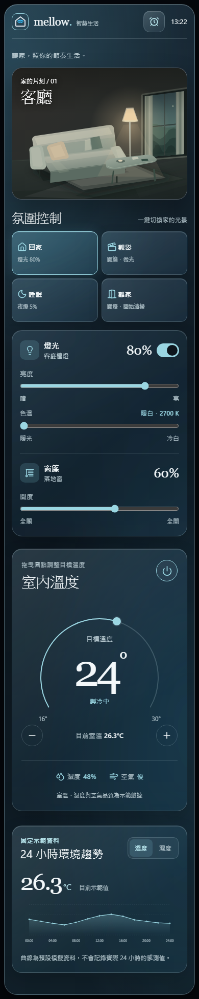
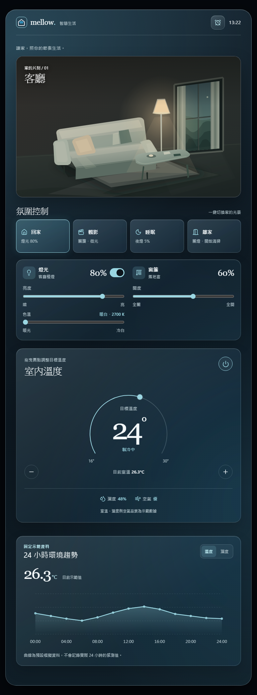
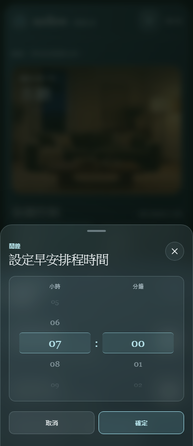

# mellow. 智慧生活

以 **Vue 3 + TypeScript** 製作的智慧家庭互動展示，專為手機與平板設計。使用者可以在同一個畫面查看夜晚客廳，調整檯燈、窗簾與目標溫度，切換生活氛圍，並透過鬧鐘面板設定早晚排程。

> 這是純前端 Demo：畫面與裝置狀態會即時連動，但不會控制真實家電。

## 畫面預覽

| 手機主畫面 | 平板主畫面 |
| --- | --- |
|  |  |

鬧鐘的時間選擇器：



## 快速開始

需要 Node.js、npm，以及支援現代 JavaScript 的瀏覽器。在專案根目錄執行：

```bash
npm ci
npm run dev
```

依終端機顯示的本機網址開啟網站。常用指令：

| 指令 | 用途 |
| --- | --- |
| `npm run dev` | 啟動 Vite 開發伺服器 |
| `npm run build` | 執行 TypeScript 檢查並產生正式版至 `dist/` |
| `npm run preview` | 在本機預覽正式版 |
| `npm run test:e2e` | 執行 Playwright 瀏覽器測試 |

## 操作指南

### 客廳與裝置

- **燈光**：使用開關控制檯燈；拖曳亮度滑桿可調整室內照明，色溫滑桿可在暖白與冷白間調整。客廳插畫的光線會跟著變化。
- **窗簾**：拖曳開度滑桿，右側窗戶的布簾會從中央向左右拉開。打開時有柔和月光進入客廳，檯燈關閉時仍可看清附近家具。
- **室內溫度**：拖曳圓形控制器、使用加減按鈕或鍵盤調整目標溫度，範圍為 16–30°C。畫面另外顯示模擬的目前室溫、濕度與空氣品質。
- **環境趨勢**：可切換查看預設的 24 小時溫度或濕度曲線。

### 氛圍控制

點選氛圍卡片會一次更新相關的燈光、窗簾與空調設定；之後手動調整裝置時，卡片的選取狀態會取消。

| 氛圍 | 燈光 | 窗簾 | 空調目標 |
| --- | --- | --- | --- |
| 回家 | 80% 暖白 | 開啟 60% | 24°C |
| 觀影 | 12% 微光 | 全關 | 24°C |
| 睡眠 | 5% 夜燈 | 全關 | 26°C |
| 離家 | 關閉 | 全關 | 關閉 |

### 鬧鐘與排程

1. 點選頁面頂部的**鬧鐘圖示**，開啟底部面板。
2. 點選「早安排程」或「晚安排程」的時間，透過滑動、滑鼠滾輪或鍵盤調整小時與分鐘，再按「確定」。
3. 開啟該排程右側的開關。預設時間為早上 `07:00`、晚上 `23:00`，兩者預設均未啟用。

早安排程會套用「回家」氛圍，晚安排程會套用「睡眠」氛圍。排程以**台北時間**比對，網頁開啟時約每 30 秒檢查一次；同一排程每天最多執行一次。

## 資料保存與展示限制

- 燈光、窗簾、空調與排程設定儲存在目前瀏覽器的 `LocalStorage`；重新整理後保留。清除網站資料、使用另一個瀏覽器或無痕視窗時不會共用。
- 目前室溫、濕度、空氣品質與 24 小時曲線是固定模擬資料，不是感測器讀值；調整目標溫度不會改變模擬室溫。
- 客廳畫面是原創 SVG 插畫，檯燈、窗簾與月光依控制狀態改變；窗簾開合是畫面示意，並非即時 3D 模擬。
- 排程依賴開啟中的網頁，關閉網頁後不會在背景執行，也不會發出手機系統鬧鈴或推播。
- 專案沒有後端、帳號、雲端同步或真實 IoT 設備連線。

## 開發與驗證

執行 TypeScript 檢查及正式版建置：

```bash
npm run build
```

首次執行端對端測試前，安裝 Playwright 的 Chromium：

```bash
npx playwright install chromium
npm run test:e2e
```

測試涵蓋燈光、窗簾、溫控、氛圍與排程的主要操作及狀態保存，並檢查 1024、768、390、375px 寬度下的水平溢出。截圖位於 `docs/screenshots/`，是展示用畫面；測試執行時產生的檔案不會提交到 Git。

## 技術組成

- **介面**：Vue 3 Composition API、Vue Router、SCSS、CSS Variables、Lucide Icons
- **狀態與資料**：Pinia、LocalStorage、專案內 Mock Data
- **開發與測試**：Vite、TypeScript、Playwright
