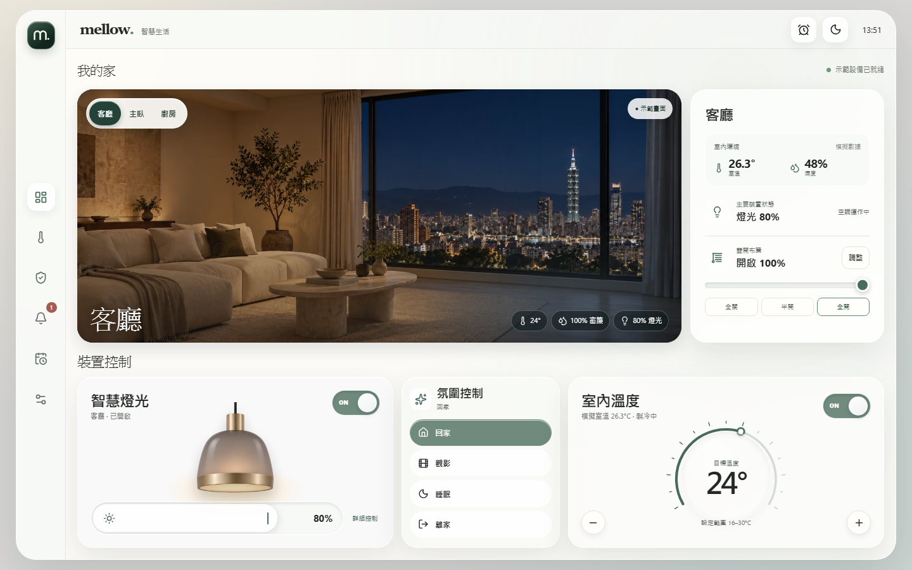
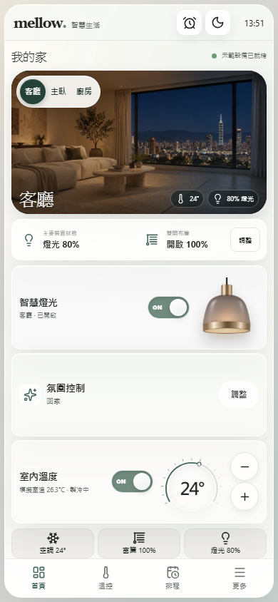

# mellow.｜Smart Home Dashboard

以 Vue 3 與 TypeScript 打造的智慧家庭互動作品。單螢幕 Dashboard 整合三房間切換、燈光、窗簾、溫控與氛圍情境；全站採用透明毛玻璃設計，支援桌機、平板及手機。

## 畫面預覽

桌機 Dashboard



手機 Compact Dashboard



## 核心功能

- 客廳、主臥、廚房共用一個實景展示區，各房間的設定獨立保存。
- 亮度 0～100% 連續控制，燈光開關與房間實景的人工照明同步。
- 窗簾 0～100% 無段式開合，窗邊月光隨開度變化。
- 16～30°C 圓形溫控器，支援拖曳、觸控、鍵盤與加減按鈕。
- 回家、觀影、睡眠、離家四種氛圍情境；手動調整裝置後更新情境選取狀態。
- 排程新增、編輯、啟停、刪除及通知中心；Light / Dark UI 主題和房間照明分開管理。
- Pinia 集中管理狀態，使用 localStorage 保存設定。

## 技術

Vue 3 · TypeScript · Vite · Pinia · Vue Router · SCSS · Lucide Icons · Playwright

## 本機執行

需要 Node.js 與 npm。在專案目錄執行：

```bash
npm ci
npm run dev
```

驗證與正式版建置：

```bash
npm run build
npm run test:e2e
```

首次執行瀏覽器測試前，請安裝 Playwright Chromium：`npx playwright install chromium`。

## Demo 限制

這是純前端模擬作品，沒有真實 IoT 設備、後端或雲端同步。房間照片與環境數據用於示範。排程僅在網頁開啟期間檢查，關閉網頁後不會在背景執行。
